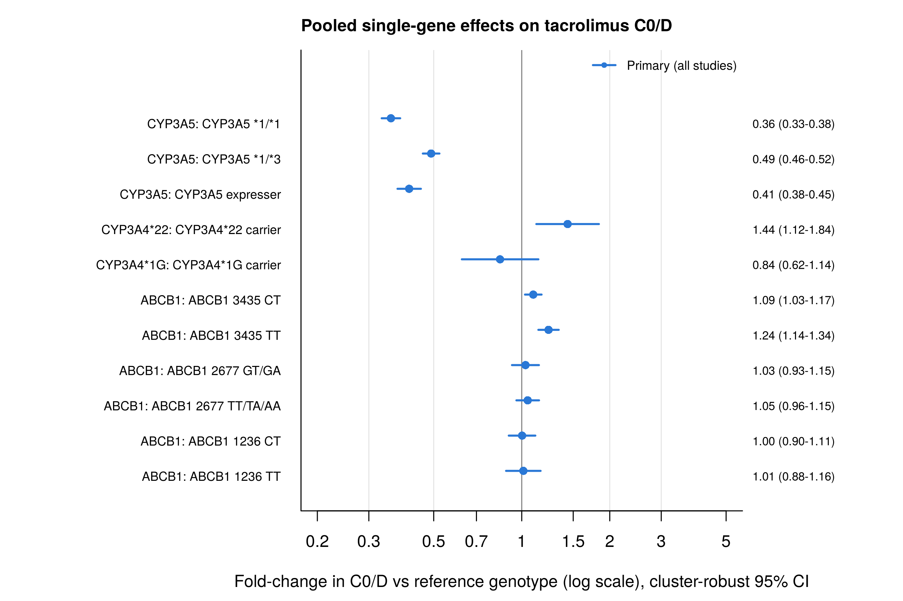

# tacrolimus-pgx-meta-analysis

[](LICENSE)
[](CHANGELOG.md)
[](https://doi.org/10.17605/OSF.IO/XAPBR)
[](https://www.r-project.org/)

An R pipeline for a meta-analysis of how CYP3A4, CYP3A5 and ABCB1 polymorphisms affect tacrolimus dose-adjusted trough concentration (C0/D) in solid organ transplant recipients. One command runs the models, the sensitivity analysis, the ancestry analysis, the figures and an Excel summary.

Developed for an MSc advanced project at Umeå University (course 5MO134), supervised by Dr. Naushad Rais (MAHE Dubai). The review protocol is registered on OSF: [10.17605/OSF.IO/XAPBR](https://doi.org/10.17605/OSF.IO/XAPBR). The six target SNPs are CYP3A5 rs776746 (*3), CYP3A4 rs35599367 (*22) and rs2242480 (*1G), and ABCB1 rs1045642 (3435C>T), rs2032582 (2677G>T/A) and rs1128503 (1236C>T).

**Contact:** kvs.ms.2512@gmail.com | GitHub: [KvS-25](https://github.com/KvS-25)

---

## Table of Contents

- [What it does](#what-it-does)
- [Requirements](#requirements)
- [Installation](#installation)
- [Quick start (example data)](#quick-start-example-data)
- [Using your own data](#using-your-own-data)
- [Running steps separately](#running-steps-separately)
- [Output structure](#output-structure)
- [Methods in brief](#methods-in-brief)
- [Protocol registration](#protocol-registration)
- [Known limitations](#known-limitations)
- [Citation](#citation)
- [License](#license)

---

## What it does

1. Reads a data workbook (one row per genotype group per timepoint per study).
2. Cleans and classifies genotype labels, drops donor and ambiguous rows, applies study-level exclusions.
3. Fits one multilevel random-effects model per SNP (`metafor::rma.mv`) on log C0/D with the reference genotype as the intercept, so coefficients are fold-changes with cluster-robust 95% CIs.
4. Stratifies the CYP3A5 model by organ, age group and time window, and by ancestry.
5. Runs leave-one-out, NOS meta-regression, and exploratory small-study checks.
6. Repeats everything without `OVERLAP-RISK` studies (sensitivity run).
7. Writes eight plots (F1 to F8), CSVs and one Excel workbook of tables.



*Output from the synthetic example data, not real results.*

---

## Requirements

- R 4.3 or newer (developed on 4.6.1, metafor 5.2.1; also tested on R 4.3.3, metafor 4.4.0)
- Internet access the first time, to install CRAN packages: readxl, dplyr, tidyr, stringr, metafor, purrr, tibble, yaml, writexl

No other software is needed. Runtime on the example data is under a minute. On a larger dataset (several hundred rows) the leave-one-out step takes several minutes.

---

## Installation

```
git clone https://github.com/KvS-25/tacrolimus-pgx-meta-analysis.git
cd tacrolimus-pgx-meta-analysis
Rscript scripts/00_install_packages.R
```

`run_all.R` also does the install step for you, so the last line is optional.

---

## Quick start (example data)

From the repo root:

```
Rscript run_all.R
```

This creates `config/config.yaml` from the template (pointing at `test_data/example_workbook.xlsx`), runs the main and sensitivity analyses, and writes everything to `results/`.

The example workbook is **synthetic**. Author names, Study IDs and values are invented, and effect sizes were simulated around plausible values (CYP3A5 expressers about 0.4 times the C0/D of non-expressers, a mild ABCB1 3435 TT effect, nulls elsewhere). It exists so you can see the expected input layout and check the pipeline runs. Regenerate it with:

```
Rscript test_data/make_example_data.R
```

---

## Using your own data

1. Put your workbook anywhere (it is gitignored if you place it in `data/`).
2. Edit `config/config.yaml`:

```
workbook: data/my_extraction.xlsx
sheet: Meta_Data_Extraction
output_dir: results
seed: 20260913
run_combined_model: false
manual_exclude: []
```

3. Run `Rscript run_all.R`.

Required columns, the Study ID flags (`OVERLAP-RISK`, `DUPLICATE-RISK`) and the cleaning rules are described in [docs/data_dictionary.md](docs/data_dictionary.md). If a required column is missing the script stops and prints the column names it found.

---

## Running steps separately

```
Rscript scripts/01_meta_analysis.R main
Rscript scripts/01_meta_analysis.R sensitivity
Rscript scripts/02_build_tables.R
```

Each accepts a config path as an extra argument. The F1 forest plot overlays the other run if its CSV already exists, so `run_all.R` runs the main analysis a second time after the sensitivity run (about ten seconds on the example data).

If a run stops with an error, the log sink may stay open in an interactive R session. Run `sink()` before retrying.

---

## Output structure

```
results/
├── Meta_Results_Tables.xlsx        # pooled, subgroup, ancestry, leave-one-out, small-study, study-level sheets
├── main/                           # all studies except DUPLICATE-RISK
│   ├── meta_run_main.txt           # full log
│   ├── all_foldchanges.csv         # every fitted model, fold-change vs reference
│   ├── loo_cyp3a5.csv
│   ├── study_level_contrasts.csv
│   ├── small_study_tests.csv
│   ├── studies_excluded.csv
│   ├── abcb1_ambiguous_labels_set_aside.csv
│   ├── ethnicity_*.csv
│   └── plots/
│       ├── F1_summary_forest.png
│       ├── F2_CYP3A5_subgroups.png
│       ├── F3_CYP3A5_study_level.png
│       ├── F4_funnel_plots.png
│       ├── F5_leave_one_out.png
│       ├── F6_ABCB1_gradients.png
│       ├── F7_CYP3A5_gradient_by_study.png
│       └── F8_evidence_base.png
└── sensitivity/                    # same files, OVERLAP-RISK studies removed
```

---

## Methods in brief

- **Effect measure:** log of the mean C0/D (C0 when C0/D is not reported). Within-row variance is `(SD/mean)^2`.
- **Model:** `rma.mv(yi, vi, mods = ~ genotype, random = ~ 1 | study_id, method = "REML")`, genotype coded with the reference (CYP3A5 *3/*3 or non-expresser, CYP3A4 wild type, ABCB1 major-allele homozygote) as the first level. Fold-change is `exp(coefficient)`. Cluster-robust CIs are reported because rows from one study are not independent.
- **Ancestry:** free-text ethnicity is keyword-classified. The CYP3A5 model is fitted within each group with at least two studies, and the effect is compared across groups on one number per study (ANOVA and Kruskal-Wallis).
- **Funnel plots:** use total study sample size as the precision proxy (see limitations), reported as exploratory.

---

## Protocol registration

The systematic review and meta-analysis this code belongs to has a registered protocol on OSF Registries:

- DOI: [10.17605/OSF.IO/XAPBR](https://doi.org/10.17605/OSF.IO/XAPBR)
- OSF project: [osf.io/jb8af](https://osf.io/jb8af)

It is a **retrospective** registration. It was written after searching, screening, data extraction and the main analyses were complete, so it is not a preregistration. It sets out the methods as planned and as carried out, and lists the deviations between the two. Attached to the registration are the protocol document and the exact PubMed, Scopus and Embase search strings. This repository holds the analysis code referred to there. The deviations from the original plan, and where each shows up in the code, are on [docs/deviations.md](docs/deviations.md).

---

## Known limitations

- Per-genotype sample sizes are not in the extraction layout, so weights ignore n and per-study CIs are not drawn.
- ABCB1 models are not adjusted for CYP3A5 genotype.
- Rows reported as median/IQR are pooled as if mean/SD (flagged in the log, no Wan/Luo conversion).
- Combined multi-gene evidence is handled narratively. Joint-genotype cells are rarely reported with mean and SD, so no pooled combined model is fitted by default (an optional diagnostic can be switched on in the config and should not be cited).
- Small strata (fewer than about 6 studies) give unreliable robust CIs. Treat them as indicative.

---

## Citation

See [CITATION.cff](CITATION.cff) for the software. The protocol has its own DOI, [10.17605/OSF.IO/XAPBR](https://doi.org/10.17605/OSF.IO/XAPBR), and is listed as a related reference in the same file.

<sub>P.S. GitHub's "Cite this repository" button uses this file.</sub>

---

## License

MIT License. Free to use and modify with attribution.
